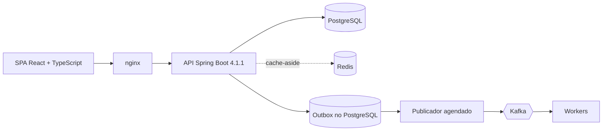

# 02 — Arquitetura

**Revisado em 17/11/2026.** O desenho [[Macro-arquitetura]] define a topologia; [[Contexo]] §5–6 define responsabilidades e regras de dependência. O ER define o schema. As regras de tempo, XP, orbit e constelações estão em [[10-domain-rules-decisions]].

## Topologia

Na `dev`, o Compose já executa a API, PostgreSQL e Redis. nginx, Kafka, outbox e workers ainda são componentes planejados. O perfil `local` permite selecionar um usuário por `X-Usuario-Id`. A autenticação por e-mail e senha com JWT e refresh token depende de #73 e #74.

Na topologia planejada, nginx recebe `/api/**` e serve o build estático. A API é um único artefato Spring Boot e a única escritora do schema principal. PostgreSQL é a fonte autoritativa; Flyway gerencia o schema com `ddl-auto=validate`. Redis é cache-aside para catálogos e leituras frequentes, com falha tratada como *miss*. O estado que decide conclusão de sessão nunca vem do cache. O worker de auditoria grava em schema separado, ainda a desenhar no ER (ABERTO-10). A posição das tarefas colaterais de autenticação segue aberta (ABERTO-03); login e emissão de token são síncronos na API.

## Hexágonos por módulo

O pacote base é `dev.amigoes.starlighttimer`. A estrutura começa pela camada em inglês (`domain`, `app`, `adapters`, `config`); os módulos também são em inglês: `identity`, `session`, `annotation`, `progression` e `social`. Exemplos: `domain/session/entities`, `domain/session/events`, `domain/progression/services`, `app/session/ports/in`, `app/session/ports/out`, `app/session/usecases` e `adapters/session/in/web`. Tipos transversais ficam em `domain/shared`, `app/shared` e `adapters/shared`; `config` concentra os beans transversais.

Domínio usa Java puro; aplicação depende do domínio e das próprias portas; adaptadores dependem do núcleo. Um módulo chama outro por porta pública de entrada ou evento de domínio in-process, sem importar modelos, serviços internos, repositórios ou entidades JPA de outro módulo. Nomes de domínio, métodos e campos usam português sem acentos; sufixos de papel das classes, pacotes e pastas usam inglês; enums copiam as migrations. Entidades JPA e DTOs web são separados dos modelos de domínio.

## AD-2 — Tempo autoritativo no servidor

O cliente deriva a contagem de timestamps ancorados no horário do servidor. O servidor usa `iniciado_em` e `sessao_evento.ocorrido_em`, desconta pausas e decide a conclusão. D-1 exige 100% do tempo de foco; D-3 permite aviso até 5 segundos antes do fim e responde `409` com segundos restantes se faltar mais. `reportado_em` é apenas informativo. Descanso também exige 100% para ser `COMPLETED`, mas rende zero XP.

D-2 permite pausa apenas em foco, com teto acumulado de 10 minutos. Ao ultrapassá-lo, a sessão vira `ABANDONED` sem XP. A sessão nasce no início (AD-3) e cada transição gera `sessao_evento`. O job conclui sessões `RUNNING` vencidas com `terminado_em` calculado; abandono é reservado aos casos próprios, incluindo pausa acima do teto.

## AD-4 — ER e migrations

Toda mudança de schema começa no ER e segue para uma migration Flyway nova. `spring.jpa.hibernate.ddl-auto=validate`; `Clock` injetado para ler o tempo; UTC no banco. A data `sessao.dia_local` é fixada no início com virada às 04:00 no fuso IANA do perfil. A API devolve erros em `ProblemDetail` (RFC 9457). Os valores válidos de enum vêm das migrations.

## AD-5 e AD-6 — Progressão

A conclusão emite evento interno (`ApplicationEventPublisher`); `progressao` concede XP, avalia insígnias e constelações na mesma transação da conclusão, de forma consistente com a resposta HTTP. `ganho_xp` é ledger append-only, com uma origem por linha. `perfil.xp_total` é cache transacional do ledger. Níveis, patentes e orbit são derivados. D-5 a D-11 estão detalhados em [[10-domain-rules-decisions]].

## Eventos externos e outbox

Eventos para workers não saem diretamente do serviço para Kafka. A transação de negócio grava uma linha de outbox; um publicador agendado envia ao Kafka e marca como publicada. A entrega é *at-least-once*, então consumidores deduplicam pelo ID do evento. A tabela de outbox já está no ER. A #69 definiu os tópicos, o envelope JSON versionado e o primeiro lote de eventos em [Mapeamento de Eventos](11-event-mapping.md). A migration e a publicação no Kafka seguem na #77. O schema de auditoria é tratado na #83 (BL-13).

## Fora do MVP

WebSocket e salas co-op, presença, música, lembretes, cosméticos e ranking de amigos são posteriores. D-10 já define ranking semanal por minutos de foco, reiniciado segunda às 00:00 em `America/Sao_Paulo`; ele pode ser calculado na leitura. Não criar snapshots sem requisito de histórico.
