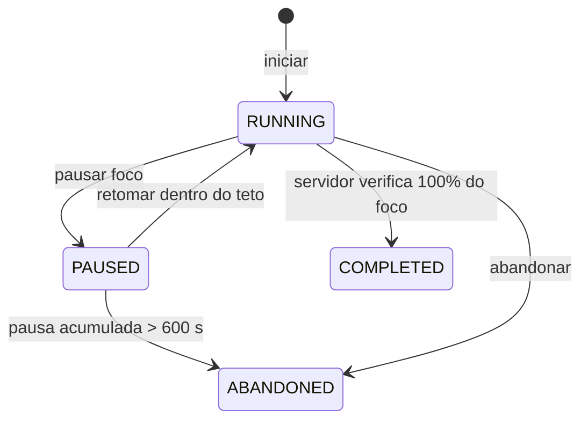

# 10 — Decisões de Regras de Domínio

## Resumo

**Revisão de 05/11/2026:** confirmado que ultrapassar 10 minutos de pausa leva a sessão a `ABANDONED`. Esta decisão prevalece sobre a antiga regra de rejeitar apenas a conclusão em `Contexo.md`; a nota âncora foi alinhada.

Os itens **D-1 a D-11** do 05 — Checklist de Planejamento estão resolvidos. Este documento registra cada decisão, o motivo por trás dela e o que muda no ER e nos outros docs. As decisões saíram de uma sessão de questionamento em quatro rodadas, apoiada no ER atual e no catálogo de títulos, insígnias e constelações.

Leia na ordem: as regras do ciclo vêm primeiro porque todo o resto (XP, orbit, insígnias, ranking) é derivado delas. A regra transversal é uma só: **toda progressão deriva de estrelas, e só o servidor decide o que é uma estrela.**

| Item | Decisão em uma linha |
| --- | --- |
| **D-1** Ciclo concluído | 100% do tempo de foco, medido pelo servidor; abandonado vale zero |
| **D-2** Pausa | Só no foco; teto acumulado de 10 min; estourou, vira `ABANDONED` |
| **D-3** Tolerância de relógio | 5 s para aviso antecipado do cliente; acima disso, `409` |
| **D-4** Escala dos estágios | Proporcional à duração |
| **D-5** Fórmula de XP | 1 XP por minuto planejado + recompensas de insígnia e constelação; sem bônus |
| **D-6** Níveis e patentes | Teto no nível 60; 12 patentes, uma a cada 5 níveis |
| **D-7** Orbit | ≥ 1 estrela por dia lógico; dia vira às 04:00 no fuso do perfil |
| **D-8** Anotações privadas | Não compartilhadas com ninguém; autorização por linha |
| **D-9** Insígnias | 22 no MVP, em 4 faixas de recompensa |
| **D-10** Ranking | Semanal, por minutos de foco, reinicia segunda 00:00 (São Paulo) |
| **D-11** Constelações | Conjunto de insígnias + mínimo de estrelas; 6 entram no MVP |

## Ciclo de foco e descanso (D-1 a D-4)

Um ciclo de foco vira estrela quando o servidor mede 100% do tempo planejado, descontadas as pausas. O cliente renderiza a contagem e avisa, mas quem decide é o servidor.

**Só o servidor leva uma sessão a COMPLETED**

Pausa só existe no foco, e nenhum caminho leva a `COMPLETED` sem o servidor medir 100% do tempo de foco.

### Durações permitidas

Foco vai de 15 a 90 min, em passos de 5 min. Pausa curta vai de 3 a 15 min. A pausa longa (D-12) fica fora do MVP.

A faixa é validada no DTO e por `CHECK` no banco. Ela existe para evitar extremos: um ciclo de 2 min atravessa os seis estágios num piscar, e um de 4 h torna pausa e tolerância sem sentido.

### D-1 — O que conta como concluído

- **100% do tempo de foco, sem limiar percentual.** Um limiar de 90% faria a duração real ser 0,9 × planejado e convidaria um botão "terminar agora" no estágio Supernova, que é justamente o de "termine o raciocínio".
- **O servidor declara a conclusão.** O `PATCH {status: COMPLETED}` do cliente é só um gatilho de verificação. Se o tempo acabou com a aba fechada, a sessão vira `COMPLETED` no próximo contato do cliente ou pelo job agendado.
- **`terminado_em = iniciado_em + planejado + pausa total`**, ou seja, quando o ciclo de fato terminou, não quando alguém percebeu.
- **O job do AD-3 muda de comportamento:** sessões `RUNNING` vencidas viram `COMPLETED`, não `ABANDONED`. Isso é coerente com o requisito de MVP de que a sessão sobrevive ao fechamento da aba.
- **Ciclo abandonado vale zero:** sem XP, sem estrela, sem *in orbit*, sem orbit. Ele aparece no Star Log com o tempo real focado, para que a estatística continue honesta. XP parcial convidaria a iniciar ciclos de 90 min e abandoná-los.
- **Descanso segue a mesma regra dos 100%.** Pular o descanso o torna `ABANDONED`. Descanso rende 0 XP.
- **Um descanso pertence a um foco** quando começa até 2 min depois do `terminado_em` desse foco. O vínculo é derivado na leitura, sem coluna nova. Com `iniciar_pausa_auto` ligado, o intervalo é zero.

### D-2 — Pausa

- Só ciclos de foco podem ser pausados. Descansos só podem ser pulados, e não contam para o teto.
- O número de pausas é livre, mas a soma delas tem **teto de 10 min por ciclo**. Ao estourar, a sessão vira `ABANDONED`.
- *In orbit* = soma de `tempo_de_foco` dos ciclos concluídos. Tempo de pausa nunca conta.
- Pausa e retomada são linhas em `sessao_evento`. Todo cálculo usa o horário carimbado pelo servidor.

O caso que motivou o D-2, um ciclo pausado por duas horas e depois concluído, agora termina em `ABANDONED` aos 10 min de pausa.

### D-3 — Tolerância de relógio

Como o servidor conclui sozinho, a tolerância só cobre um caso: o cliente avisar a conclusão um pouco antes do fim calculado pelo servidor.

- Faltando **até 5 s**, o servidor aceita e conclui com `terminado_em = agora`.
- Faltando mais, responde **`409`** com os segundos restantes. O cliente mantém a tela em 00:00, no estágio Supernova, com um estado de "finalizando", e tenta de novo.

Como o cliente ancora a contagem no `serverTime`, o desvio real deve ficar abaixo de 1 a 2 s. Pausas não precisam de tolerância, porque quem carimba o horário é o servidor.

### D-4 — Escala dos estágios

Os estágios são **proporcionais** à duração, como no protótipo. Num ciclo de 15 min a Nebula dura 3 min; num de 90 min a Main Sequence dura cerca de 25 min, o que combina com "trabalho profundo".

Com estágios fixos em minutos, um ciclo de 15 min nunca chegaria à Supernova. A proporção também mantém `deriveStage(progress, mode)` como função pura.

## XP, níveis e patentes (D-5, D-6)

Um ciclo de foco concluído rende 1 XP por minuto planejado, e o nível 60 exige 45.725 XP: cerca de 21 meses para um usuário regular, ou 17 contando as recompensas.

### D-5 — Fontes de XP

O XP vem de exatamente três fontes, uma por coluna `origem_*` de `ganho_xp`:

| Fonte | Valor | Coluna de origem |
| --- | --- | --- |
| Ciclo de foco concluído | 1 XP por minuto planejado (15 a 90 XP) | `origem_sessao` |
| Insígnia desbloqueada | `insignia.xp_recompensa` (50, 150, 400 ou 1.000) | `origem_insignia` |
| Constelação desbloqueada | `constelacao.xp_recompensa` = 5 × `qtd_estrelas` | `origem_constelacao` |

- **XP linear** faz nenhuma duração ser "ótima para farmar". XP fixo por ciclo incentivaria ciclos de 15 min; XP superlinear, ciclos de 90.
- **Descanso rende 0 XP.** Ele é recompensado pelas insígnias de ritmo.
- **Sem bônus de streak, de ciclo sem pausa ou de co-op.** Ficam para outro escopo. Streak e ciclo sem pausa já são reconhecidos por insígnias; bônus por ciclo recompensaria a mesma coisa duas vezes.
- O `CHECK` de "exatamente uma `origem_*` preenchida" continua valendo sem coluna nova. `STREAK_BONUS` e `COOP_BONUS` saem da lista de origens.

Recompensas somam cerca de 20% do XP até o nível 60 (6.500 das insígnias + 2.425 das constelações). O ciclo de foco continua sendo a fonte principal.

### D-6 — Curva de níveis

O custo para subir do nível *n* para o *n+1* é 50 + 25·(n−1). A coluna `limite_nivel.xp_necessario` guarda o **acumulado**:

$$\mathrm{xp\_necessario}(n) = 50\,(n-1) + 12{,}5\,(n-1)(n-2)$$

O resultado é sempre inteiro. Descobrir o nível do usuário é uma consulta: o maior `nivel` cujo `xp_necessario` não passa do total. O nível máximo é **60**, e as 60 linhas são geradas na migration. No nível 60 o XP continua entrando no ledger, mas o nível para.

A calibração assume um "usuário regular" de 4 ciclos de 25 min por dia, 5 dias por semana: cerca de **500 XP por semana**. Com isso, o nível 2 chega em 2 ciclos (ou 1, com a recompensa da First Light) e o nível 10 em menos de 3 semanas.

### D-6 — Patentes

As 12 patentes do catálogo mudam a cada 5 níveis. A patente é derivada de `patente.nivel_minimo`; a coluna `limite_nivel.patente_id` sai, porque guardava a mesma informação em dois lugares.

| Patente | Nível mínimo | XP acumulado | Tempo aprox. a 500 XP/semana |
| --- | --- | --- | --- |
| Stargazer | 1 | 0 | — |
| Star Seeker | 6 | 500 | 1 semana |
| Astral Voyager | 11 | 1.625 | 3 semanas |
| Stellar Navigator | 16 | 3.375 | 7 semanas |
| Stellar Cartographer | 21 | 5.750 | \~3 meses |
| Starforger | 26 | 8.750 | \~4 meses |
| Celestial Warden | 31 | 12.375 | \~6 meses |
| Nova Commander | 36 | 16.625 | \~8 meses |
| Astral Sovereign | 41 | 21.500 | \~10 meses |
| Quasar Sovereign | 46 | 27.000 | \~1 ano |
| Celestial Architect | 51 | 33.125 | \~15 meses |
| Cosmic Architect | 56 | 39.875 | \~18 meses |

Os tempos não contam o XP de recompensas. O espaçamento uniforme funciona porque a curva crescente já faz as primeiras patentes chegarem mais rápido no calendário. Os números do protótipo (nível 12 com 218 estrelas) eram ilustrativos e não batem com esta curva.

## Orbit e dia lógico (D-7)

A orbit continua enquanto houver pelo menos uma estrela por dia lógico, e o dia lógico vira às 04:00 no fuso do perfil.

- **O que mantém a orbit:** pelo menos um ciclo de **foco** concluído no dia lógico. Ciclo apenas iniciado não conta; descanso também não.
- **Dia da sessão:** o dia do *ignite*, não o do término.
- **Sem "streak freeze"** no MVP.
- **Sem tabela de streak.** A orbit é calculada na leitura a partir de `sessao`, agrupando por `dia_local`. Isso fica registrado como decisão, não descoberto por ausência.

### Dia lógico e fuso

- **Virada às 04:00 locais.** Quem foca entre 00:00 e 03:59 conta para o dia anterior. Isso resolve a persona que trabalha depois da meia-noite.
- **Dia congelado na criação.** A sessão ganha `dia_local DATE NOT NULL`, preenchido com o fuso vigente no *ignite*. Viajar ou trocar de fuso não reescreve orbits passadas.
- **`perfil.fuso_horario` obrigatório no cadastro**, pré-preenchido pelo navegador com `Intl.DateTimeFormat().resolvedOptions().timeZone`.

A insígnia Night Watch não usa o dia lógico: ela olha a hora local do *ignite* (00:00 a 03:59).

## Anotações privadas (D-8)

"Privada" significa não compartilhada com ninguém, com autorização por linha: a leitura 1 do doc 03.

- **Sem coluna `visibility`.** O doc 01 diz que anotações são "nunca visíveis a terceiros", então notas compartilhadas (leitura 3) contradizem a visão do produto. A âncora proposta no doc 08 sai, como o ER já fez.
- **Sem criptografia contra operadores** (leitura 2). Ela quebraria busca e tornaria a redefinição de senha destrutiva, um custo que um projeto de disciplina não justifica.
- **Fica documentado que operadores conseguem ler o banco.** Se o projeto for publicado, esta decisão volta para a mesa junto com L-2.

## Insígnias (D-9)

Das 28 insígnias do catálogo, 22 entram no MVP e somam 6.500 XP de recompensa. As outras 6 dependem de features que ainda não existem.

### Critérios e recompensas

Definições: **estrela** = ciclo de foco `COMPLETED`; **dia ativo** = dia lógico com pelo menos uma estrela; janelas de horário usam a hora local do *ignite*.

| Insígnia | Critério | Avaliador | XP |
| --- | --- | --- | --- |
| First Light | 1 estrela | contagem de estrelas | 50 |
| Ignition Sequence | 10 estrelas | contagem de estrelas | 50 |
| Supernova | 50 estrelas | contagem de estrelas | 150 |
| Stellar Forge | 250 estrelas | contagem de estrelas | 400 |
| A Thousand Suns | 1.000 estrelas | contagem de estrelas | 1.000 |
| Silent Core | 10 estrelas com `tempo_de_pausa = 0` | contagem com filtro | 50 |
| Night Watch | 10 estrelas iniciadas entre 00:00 e 03:59 | contagem com filtro | 150 |
| Dawnbringer | 10 estrelas iniciadas entre 05:00 e 07:59 | contagem com filtro | 150 |
| Meridian | 10 estrelas iniciadas entre 11:00 e 13:59 | contagem com filtro | 150 |
| Deep Field | 25 h de foco (1.500 min) | minutos de foco | 150 |
| Event Horizon | 500 h de foco | minutos de foco | 1.000 |
| First Orbit | orbit de 3 dias | orbit | 50 |
| Steady Orbit | orbit de 7 dias | orbit | 150 |
| Unbroken Orbit | orbit de 30 dias | orbit | 400 |
| Stellar Legacy | 365 dias ativos, não consecutivos | dias ativos | 1.000 |
| Cooling Nebula | 25 descansos concluídos vinculados a um foco | contagem de descansos | 150 |
| Celestial Scribe | 10 anotações ligadas a sessões concluídas | anotações | 50 |
| Astral Chronicle | anotações criadas em 30 dias lógicos distintos | anotações | 400 |
| Celestial Clockwork | ≥ 20 dias ativos em qualquer janela de 30 dias lógicos consecutivos | código | 400 |
| Stable Fusion | 7 dias lógicos com ≥ 4 estrelas, toda estrela seguida de descanso concluído | código | 400 |
| Reignition | 1 estrela após ≥ 14 dias lógicos sem nenhuma, com histórico anterior | código | 50 |
| Phoenix Flame | orbit de 7 dias depois de já ter perdido uma orbit de 7 ou mais | código | 150 |

O avaliador genérico do doc 03 cobre 18 insígnias com uma consulta parametrizada ("conte X com filtro ≥ N"). Só as quatro marcadas como "código" ficam em classes próprias. Deep Field em 25 h e Supernova em 50 batem com o "12 / 25" e o "×50" do protótipo.

### Faixas de recompensa

Quatro faixas: **50, 150, 400 e 1.000 XP**, conforme a dificuldade. Faixas tornam a regra explicável em uma linha e fácil de aplicar a insígnias futuras. Duas escolhas deliberadas:

- **First Light vale 50.** O primeiro ciclo rende 25 + 50 = 75 XP, e o usuário sobe para o nível 2 na primeira sessão.
- **Reignition vale só 50.** Recompensa alta por voltar depois de 14 dias incentivaria sumir de propósito.

Guardem só `xp_recompensa`. Se o `<BadgeMedal>` precisar de cor por faixa, ela pode ser derivada do valor ou virar coluna depois.

### Regras gerais

- O desbloqueio é **permanente**.
- `contagem_progresso` guarda o **melhor valor já atingido** e nunca regride. Para as insígnias de orbit, é a maior orbit já alcançada.
- A avaliação acontece **no momento do evento**, com o fuso vigente naquele momento.
- Astral Chronicle conta pelo dia lógico de `criado_em`, não por `data_anotacao`. Senão daria para escrever 30 notas com datas diferentes numa tarde.

### Fora do MVP

| Insígnia | Depende de |
| --- | --- |
| Binary Stars, Shared Gravity, Starbound Fellowship | Salas co-op (R-1 a R-5) |
| Orbital Resonance | Meta semanal pessoal (Orbit Goals) |
| Gravitational Lock, Stellar Rhythm | Uma "rotina planejada", conceito que depende de D-12 e presets |

### Nomes que também são estágios

"Supernova" e "Cooling Nebula" são estágio e insígnia, e "Supernova" também é o alerta sonoro. Os nomes ficam: a insígnia homenageia o estágio de propósito.

A ambiguidade se resolve por código. Estágios ficam no enum de `deriveStage` (`SUPERNOVA`); insígnias em `insignia.codigo` (`BADGE_SUPERNOVA`, `BADGE_COOLING_NEBULA`). Um ticket que diga só "Supernova" deve ser recusado por ambiguidade.

## Ranking de amigos (D-10)

O ranking é semanal, ordena por minutos de foco concluídos e reinicia toda segunda às 00:00 de `America/Sao_Paulo`. A feature continua pós-MVP; as regras ficam fechadas desde já.

- **Semanal, não vitalício.** Todo mundo zera na segunda, o que resolve o problema do novato contra o veterano de seis meses. Os totais vitalícios ficam no perfil, sem ranking.
- **Fuso único para todos**, porque o ranking é comparativo.
- **Métrica: minutos de foco concluídos na semana** (o *in orbit* semanal), não XP. XP herdaria os saltos das insígnias: quem desbloqueasse A Thousand Suns numa semana subiria sem ter focado mais.
- **Desempate:** primeiro mais estrelas na semana; depois, quem atingiu o total primeiro.
- **Calculado na leitura**, sem `LEADERBOARD_SNAPSHOT`. A tabela só voltaria se alguém pedir histórico de rankings passados.

XP continua sendo a métrica de nível e patente, que não são competitivos.

## Constelações (D-11)

Uma constelação é um conjunto nomeado de insígnias, e desbloqueá-la exige duas condições ao mesmo tempo: pelo menos `qtd_insignias_requeridas` insígnias do conjunto **e** pelo menos `qtd_estrelas` estrelas forjadas.

### As 6 constelações do MVP

Todas exigem 2 de 3 insígnias. Quem controla a dificuldade é o mínimo de estrelas, que é a métrica central do produto.

| Constelação | Insígnias | Estrelas mínimas | XP |
| --- | --- | --- | --- |
| The First Firmament | First Light, First Orbit, Cooling Nebula | 10 | 50 |
| The Eternal Compass | First Orbit, Steady Orbit, Unbroken Orbit | 50 | 250 |
| The Night Sentinel | Night Watch, Silent Core, Deep Field | 75 | 375 |
| The Starforge | First Light, Supernova, Stellar Forge | 100 | 500 |
| The Emberwing | Reignition, Phoenix Flame, Supernova | 100 | 500 |
| The Celestial Archive | Celestial Scribe, Astral Chronicle, Stellar Legacy | 150 | 750 |

Em todas, o mínimo de estrelas fica acima do que as duas insígnias mais fáceis já exigiriam. O XP segue a regra de autoria **5 × `qtd_estrelas`**; o valor é guardado como dado, e a regra vale para as próximas.

A First Firmament é a constelação de onboarding: alcançável na primeira semana. Ela ataca diretamente o estado vazio do primeiro dia (F-9).

### Como a seleção foi feita

- **Regra:** uma constelação só entra se **todas** as suas insígnias estão no MVP. Assim "2 de 3" nunca vira, sem ninguém perceber, "2 das 2 que existem".
- **Só as inventadas.** Elas mantêm a linguagem "The X" coerente. Orion e Phoenix se sobrepõem quase inteiramente a Starforge e Emberwing.
- **Arte limita.** Cada constelação exige um `asset_svg` desenhado; seis desenhos já é bastante para o MVP.
- **Ficam de fora:** The Silent Observatory (mesmas insígnias da Night Sentinel, seriam desbloqueadas juntas) e as reais elegíveis (Orion, Phoenix, Aquila, Andromeda), que ficam como uma futura expansão "do céu real".

### Comportamento

- **"Constelação perfeita"** é só visual: com a terceira insígnia, o ponto apagado do desenho acende. Não dá XP nem desbloqueia nada, e é derivada de `insignia_usuario`, sem coluna nova.
- **O desbloqueio escuta dois eventos:** insígnia desbloqueada e sessão concluída. Quando o mínimo de estrelas é o último requisito, quem o completa é uma estrela, não uma insígnia.
- `constelacao_usuario` guarda só desbloqueios; o progresso é derivado na leitura.
- **Constelações entram no MVP**, o que reabre o P-1. O doc 01 as deixava fora; o ER já as incluía.

## Impacto no ER

As decisões pedem uma coluna nova, duas recompensas, uma remoção e alguns `CHECK`s; nenhuma tabela nova.

| Tabela | Mudança | Decisão |
| --- | --- | --- |
| `sessao` | + `dia_local DATE NOT NULL`, preenchido no *ignite* | D-7 |
| `sessao` | `CHECK` de duração por `tipo`: foco de 900 a 5400 s, múltiplo de 300; pausa curta de 180 a 900 s | Durações |
| `configuracoes_usuario` | Mesmos `CHECK`s de faixa em `foco_em_segundos` e `pausa_em_segundos` | Durações |
| `perfil` | `fuso_horario` passa a `NOT NULL` | D-7 |
| `insignia` | + `xp_recompensa INTEGER NOT NULL` | D-5, D-9 |
| `constelacao` | + `xp_recompensa INTEGER NOT NULL` | D-5, D-11 |
| `limite_nivel` | − `patente_id`; `xp_necessario` passa a ser acumulado | D-6 |
| `sessao_evento` | `ocorrido_em` = carimbo do servidor (usado em cálculos); `reportado_em` = horário do cliente (só diagnóstico) | D-2, D-3 |
| `ganho_xp` | Sem mudança: o `CHECK` de uma origem só continua valendo | D-5 |
| `anotacao` | Sem mudança: continua sem `visibility` | D-8 |

### Seeds

Os catálogos são dado (decisão do doc 08), então entram por migration:

- 12 linhas em `patente`, com `nivel_minimo` de 1 a 56, de 5 em 5.
- 60 linhas em `limite_nivel`, geradas pela fórmula da curva.
- 22 linhas em `insignia`, com critério, `tipo_criterio`, `conta_alvo` e `xp_recompensa`.
- 6 linhas em `constelacao` e 18 em `insignia_constelacao`.

Os nomes cabem nas colunas atuais: o maior nome de constelação tem 21 caracteres para um `VARCHAR(30)`.

## Impacto nos outros docs

As notas estão indexadas em [README](README-INTERNAL.md). A #66 reúne a revisão das notas do Obsidian e sua publicação na branch de referência `dev-docs`. O alinhamento dos guias na branch de código continua em BL-15. O ER deve receber qualquer mudança de schema antes da respectiva migration.

## Como prosseguir

Com D-1 a D-11 fechados, compare o ER e as migrations já existentes com estas regras antes de criar novas migrations. Para mudanças na implementação, siga o fluxo do doc 06 com branches curtas a partir de `dev`.

- [ ] **Revisar este doc em time.** Quem discordar de uma decisão comenta nela antes do PR; `sessao_evento` já tem semântica confirmada em [Contexo](Contexo.md).
- [ ] **Alinhar os guias da branch de código em PR próprio.** A publicação das notas na `dev-docs` é acompanhada pela #66.
- [ ] **Atualizar o diagrama ER** antes de migrations novas, preservando a hierarquia de fontes de [Contexo](Contexo.md).
- [ ] **Revisar as migrations existentes e criar apenas migrations novas para diferenças aprovadas no ER.** Os catálogos iniciais já estão na V6.
- [ ] **Implementar `deriveStage`** como função pura e conferir manualmente as fronteiras 0,199/0,200, 0,399/0,400, 0,679/0,680 e 0,879/0,880.
- [ ] **Verificar as regras de borda conforme a política Q-4 em [Contexo](Contexo.md) §10.1.** Casos prioritários:
  - teto de pausa: 600 s ainda vale; 601 s vira `ABANDONED`;
  - tolerância: aviso a 5 s do fim é aceito; a 6 s, `409`;
  - sessão concluída com a aba fechada vira `COMPLETED` com o `terminado_em` calculado, não o da detecção;
  - dia lógico: ignite às 03:59 conta para o dia anterior; às 04:00, para o dia corrente;
  - troca de fuso não altera o `dia_local` de sessões passadas;
  - `xp_necessario(60) = 45.725` e a fórmula dá inteiro para todos os níveis;
  - constelação desbloqueada por uma estrela quando as insígnias já estavam completas.
- [ ] **Construir o avaliador genérico de insígnias** só depois das três primeiras insígnias de contagem funcionando com código direto, como pede o doc 03.

Registre no PR os comandos ou passos de verificação executados e os resultados. A verificação manual complementa a cobertura automatizada.

## Pendências e fora de escopo

As regras abaixo ficam fora do MVP ou dependem de decisões próprias.

**Confirmado em [Contexo](Contexo.md) e nas migrations:** `ocorrido_em` é o horário do servidor; `reportado_em` é o horário informado pelo cliente.

| Item | Situação |
| --- | --- |
| Bônus de XP (streak, sem pausa, co-op) | Fora de escopo por decisão; volta junto com R-5 |
| D-12 — Pausas longas | Fora do MVP; Gravitational Lock e Stellar Rhythm dependem dela |
| R-1 a R-8 — Salas co-op | Abertos; as três insígnias sociais esperam por eles |
| Constelações reais e The Silent Observatory | Pós-MVP, como expansão "do céu real" |
| Macro-arquitetura com Kafka, Redis e workers | Definida no diagrama macro, em [Contexo](Contexo.md) e alinhada em [02-architecture](02-architecture.md) |
| PK `UUID` no ER | Convenção vigente, registrada em [03-domain-model](03-domain-model.md) |
| Âncora `room_id` em `sessao` | Descartada do MVP, registrada em [08-entity-inventory](08-entity-inventory.md) |
| L-2, L-6, L-7 e criptografia de anotações | Voltam para a mesa se o projeto for publicado |
