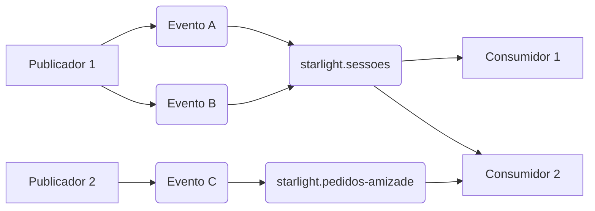

# 11 - Mapeamento de Eventos (EDA)

Especificações sobre os eventos que serão utilizados na arquitetura. Contém informações acerca das convenções de tópicos do Kafka e versionamento dos payloads, abordagem no código, funcionamento do *Outbox* e lotes de eventos mapeados.

---
## Explicação Geral

Os tópicos do Kafka são uma maneira de organizar os eventos por **categoria**. Semelhante à uma revista com diversos assuntos, você não mistura notícias de futebol com receitas de bolo, você cria **categorias específicas** como "Esportes", "Economia", "Culinária", onde cada categoria funciona como um **tópico diferente no Kafka**.

Os **produtores/publicadores** escrevem os eventos e os publicam em um tópico específico. Os eventos são **imutáveis**, entram na **ordem de publicação dentro de cada partição** e são registrados em **ordem de chegada**. Os consumidores assinam tópicos específicos e reagem às suas publicações, podendo ler os dados daquele tópico de forma **independente**, formando uma relação de: **1 Produtor <> N Consumidores**.

---
## Convenções

Padrões e convenções dos tópicos e versionamento da fila de mensageria. Serão utilizados tanto por produtores, quanto por consumidores.

### Tópicos

Os tópicos seguem a estrutura `starlight.<agregado-no-plural>`, em minúsculas, sem acentos e com hífen em nomes compostos. Por exemplo, `starlight.sessoes` e `starlight.pedidos-amizade`. `id_agregado` como chave da mensagem. Isso agrupa as transições da mesma sessão na mesma partição.



### Versionamento

A API monta o envelope e o adaptador grava o JSON completo em `outbox.payload` na mesma transação da mudança de negócio. O publicador envia o envelope persistido e usa a coluna `outbox.id_agregado` como chave Kafka. Essa coluna corresponde ao campo `metadata.agregado_id` do JSON. A coluna `outbox.payload` guarda o envelope completo ([[11-event-mapping#Abordagem no código#Java|Exemplo em Java]]), o que permite preservar a versão desde a gravação até uma eventual republicação, usando as colunas do ER atual. O adaptador preenche as colunas do outbox a partir do mesmo `metadata` que serializa.

Exemplo de mensagem em `starlight.sessoes`:

```json title:sessao-concluida
{
  "metadata": {
	"id": "7d1efbc5-0c19-470b-9caf-bda4a9195d49",
	"tipo_evento": "sessao-concluida",
    "tipo_agregado": "sessao",
    "agregado_id": "15ba7d8a-44de-4b0c-8ad8-bfb13f4d24f8",
    "criado_em": "2026-11-18T18:25:00Z",
    "versao_payload": 1
  },
  "payload": {
    "usuario_id": "698c764a-52a4-4afb-960b-d256c56bd79a",
    "tipo_sessao": "FOCUS",
    "tempo_de_foco_segundos": 1500
  }
}
```

- **Compatibilidade.** Cada `tipo_evento` começa com `metadata.versao_payload` igual a `1`. Adicionar um campo opcional mantém a versão, desde que os consumidores aceitem campos desconhecidos. Remover ou renomear campos, mudar tipos, unidades ou significado exige uma nova versão. Atualize os consumidores para ler as duas versões antes de começar a publicar a nova.
- **Republicação.** `id` é o UUID da linha de outbox e permanece igual em todas as tentativas. O worker deduplica por esse ID. `id_agregado` identifica a sessão, o pedido ou o perfil e pode aparecer em várias mensagens.

---
## Abordagem no código

### Java

Os enums de mensageria têm valores externos explícitos no JSON. Por exemplo, `TipoEvento.SESSAO_CONCLUIDA` é serializado como `sessao-concluida` e `TipoAgregado.SESSAO` como `sessao`. Esses valores são parte do contrato e permanecem estáveis quando uma constante Java é renomeada.

**Record parametrizado:** `EventoEnvelope<T>`
**Records:** `EventoMetadata` & `EventoPayloadVn` (exemplo abaixo)

```java title:EventoEnvelope
public record EventoEnvelope<T>(
	EventoMetadata metadata,
	T payload
) {}
```

```java title:EventoMetadata
// Exemplo de EventoMetadata
public record EventoMetadata(
	UUID id,
	TipoEvento tipoEvento,
	TipoAgregado tipoAgregado,
	UUID agregadoId,
	Instant criadoEm,
	int versaoPayload
) {
	public static EventoMetadata gerar(
		TipoEvento tipoEvento,
		UUID agregadoId,
		int versaoPayload,
		Clock clock
	) {
		return new EventoMetadata(
			UUID.randomUUID(),
			tipoEvento,
			TipoEvento.derivarAgregado(tipoEvento),
			agregadoId,
			clock.instant(),
			versaoPayload
		);
	}
}
```

```java title:SessaoConcluidaPayloadV1
// Exemplo do payload do evento sessao-concluida visto como JSON na seção anterior
public record SessaoConcluidaPayloadV1(
	UUID usuarioId,
	TipoSessao tipoSessao,
	long tempoDeFocoSegundos
) {}
```
---
## Lotes

Lotes de eventos mapeados que serão distribuídos no sistema de mensageria (Kafka) do projeto.

**Lotes até o momento (18/11):** 1

### 1° Lote

Os campos abaixo são a proposta para `payload` na v1. Os desbloqueios ficam em `starlight.perfis`, com `agregado_id = usuario_id`, porque registram uma conquista de um usuário. O ID da insígnia ou da constelação identifica o item do catálogo.

| Tópico                      | `tipo_evento`               | `payload`                                                 | Momento do registro                                                                                                        |
| --------------------------- | --------------------------- | --------------------------------------------------------- | -------------------------------------------------------------------------------------------------------------------------- |
| `starlight.sessoes`         | `sessao-iniciada`           | `usuario_id`, `tipo_sessao`, `duracao_planejada_segundos` | Ao persistir a sessão e seu evento de início                                                                               |
| `starlight.sessoes`         | `sessao-concluida`          | `usuario_id`, `tipo_sessao`, `tempo_de_foco_segundos`     | Na conclusão validada pela API ou pelo agendador                                                                           |
| `starlight.sessoes`         | **`sessao-abandonada`**     | `usuario_id`, `tipo_sessao`, `motivo`                     | Ao persistir o abandono pelo usuário ou pelo teto de pausa.                                                                |
| `starlight.pedidos-amizade` | `pedido-amizade-enviado`    | `remetente_id`, `destinatario_id`                         | Ao criar o pedido pendente                                                                                                 |
| `starlight.pedidos-amizade` | **`pedido-amizade-aceito`** | `remetente_id`, `destinatario_id`, `amizade_id`           | Depois de carregar a amizade criada pelo trigger, ainda na mesma transação. A chave continua sendo o ID do pedido original |
| `starlight.perfis`          | `insignia-desbloqueada`     | `insignia_id`                                             | Quando o desbloqueio é gravado pela primeira vez para o usuário                                                            |
| `starlight.perfis`          | `constelacao-desbloqueada`  | `constelacao_id`                                          | Quando o desbloqueio é gravado pela primeira vez para o usuário                                                            |

**Abandono** fecha a trilha de sessões iniciadas que terminam sem conclusão, inclusive pelo agendador. **Aceite** fecha a trilha do pedido e preserva o vínculo com a amizade criada, já que o trigger apaga a linha original. Os dois casos já existem no backend.

Códigos propostos para **motivo** (Abandono): `ABANDONO_USUARIO` e `TETO_PAUSA_EXCEDIDO`.