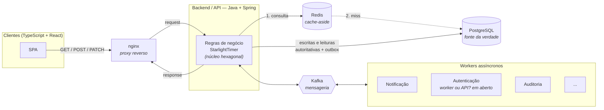

# StarlightTimer — Contexto do Projeto

> Documento-âncora do repositório. Reúne o estado atual da codebase, a arquitetura adotada, as decisões de stack, as regras de colaboração e o backlog imediato.
> 
> Serve a dois públicos ao mesmo tempo: **pessoas do time** (onboarding e referência rápida) e **assistentes de IA** usados no desenvolvimento (contexto e restrições). Se você é uma IA, leia a seção [§10 — Regras para assistentes de IA](#10--regras-para-assistentes-de-ia) antes de qualquer outra coisa e trate-a como obrigatória.
> 
> Para usar como contexto automático, copie este arquivo para a raiz como `CLAUDE.md` (Claude Code) ou `AGENTS.md` (outras ferramentas).
> 
> **Última revisão:** 17/11/2026 — registra a entrega de M0, o estado da `dev`, Q-4 e as decisões de cadastro da #66.

---

## Sumário

1. [O que é o StarlightTimer](#1--o-que-%C3%A9-o-starlighttimer)
2. [Hierarquia de fontes da verdade](#2--hierarquia-de-fontes-da-verdade)
3. [Estado atual do repositório](#3--estado-atual-do-reposit%C3%B3rio)
4. [Stack e decisões técnicas](#4--stack-e-decis%C3%B5es-t%C3%A9cnicas)
5. [Arquitetura macro](#5--arquitetura-macro)
6. [Arquitetura hexagonal no backend](#6--arquitetura-hexagonal-no-backend)
7. [Modelo de dados](#7--modelo-de-dados)
8. [Regras de domínio que o código precisa respeitar](#8--regras-de-dom%C3%ADnio-que-o-c%C3%B3digo-precisa-respeitar)
9. [Fluxo de trabalho: branches, commits, issues e PRs](#9--fluxo-de-trabalho-branches-commits-issues-e-prs)
10. [Regras para assistentes de IA](#10--regras-para-assistentes-de-ia)
11. [Como fazer (receitas)](#11--como-fazer-receitas)
12. [Divergências conhecidas entre documentos](#12--diverg%C3%AAncias-conhecidas-entre-documentos)
13. [Backlog imediato](#13--backlog-imediato)
14. [Decisões: resolvidas e em aberto](#14--decis%C3%B5es-resolvidas-e-em-aberto)
15. [Glossário rápido](#15--gloss%C3%A1rio-r%C3%A1pido)

---

## 1 — O que é o StarlightTimer

Aplicação web de Pomodoro com tema espacial e progressão gamificada. Um ciclo de foco é renderizado como o ciclo de vida de uma estrela (Nebula → Protostar → Main Sequence → Red Giant → Supernova; pausas são Cooling Nebula). Concluir um ciclo "forja" uma _star_, que gera XP, níveis, patentes, insígnias e constelações.

**Contexto do projeto:** trabalho de disciplina, desenvolvido por um time pequeno, **sem deploy público previsto** (doc 08). O objetivo declarado é o time _aprender_ a construir e raciocinar sobre uma aplicação full-stack — isso pesa em várias regras deste documento, especialmente nas de IA.

**Escopo do MVP (P-1, confirmado; o ER reflete exatamente esse escopo):**

> Autenticação + timer solo de foco/pausa com o ciclo de vida completo da estrela + persistência da sessão + histórico de sessões + anotações privadas + XP, níveis, patentes, insígnias **e constelações** + amizades.

Fora do MVP: salas co-op, música/ambiência, lembretes, cosméticos, leaderboards. Ver doc 01 para o catálogo completo.

**Marco concluído:** M0 foi entregue em **06/11/2026**, com 20 de 20 issues fechadas. O [Backlog](Backlog.md) acompanha os próximos marcos. A política de testes pós-M0 está na §10.1.

---

## 2 — Hierarquia de fontes da verdade

Os documentos foram escritos em momentos diferentes e **discordam entre si** em alguns pontos (lista em [§12](#12--diverg%C3%AAncias-conhecidas-entre-documentos)). Quando houver conflito, vale a fonte de maior prioridade:

|Prioridade|Fonte|Manda em|
|---|---|---|
|**Máxima**|[Diagrama ER](<Modelo ER - StarlightTimer(4).png>)|Tabelas, colunas, tipos, nulidade, relacionamentos, constraints|
|**Máxima**|Diagrama de [Macro-arquitetura](Macro-arquitetura.md)|Topologia: nginx, API, Redis, Kafka, workers, estilo hexagonal + event-driven|
|2|Código, migrations Flyway e `pom.xml`|Stack, versões, pacote base, **valores de enum** e tudo que os diagramas não especificam|
|3|**Este documento**|Organização hexagonal, convenções de código, regras de IA, backlog|
|3|[10-domain-rules-decisions](10-domain-rules-decisions.md)|Decisões específicas D-1 a D-11; prevalece sobre trechos anteriores deste contexto quando tratar desses IDs|
|4|`docs/08-entity-inventory.md`|Racional de escopo das entidades|
|5|Notas 01 a 09|Produto, modelo, design system, processo e planejamento|

Consequências práticas:

- **Se o código ou uma migration divergir de um diagrama, o código está errado** — abra uma issue de `fix`.
- **Toda mudança de schema começa no ER.** Uma tabela nova (por exemplo, a de outbox) é desenhada no ER primeiro e só então vira migration.
- **Toda mudança de topologia começa no diagrama macro** (por exemplo, decidir se a autenticação assíncrona vira worker).

`docs/05-planning-checklist.md` continua sendo o registro canônico de **decisões em aberto de produto**. Os IDs de lá (**P-1**, **D-7**, **AD-2**, ...) são usados aqui e em commits, issues e PRs — nunca os renomeie nem traduza.

> A cópia de referência da `dev-docs` inclui os diagramas do Obsidian. O ER publicado retrata a versão vigente do desenho. As restrições de identidade da #66 e as demais mudanças de schema planejadas continuam pendentes.

---

## 3 — Estado atual do repositório

Retrato da `dev` remota em **17/11/2026** (`51bcf45`, após o PR #106 da política de testes).

- **Backend:** na raiz, sob `src/main/java/dev/amigoes/starlighttimer`. As camadas `domain`, `app` e `adapters` contêm os módulos `identity`, `session`, `annotation`, `progression` e `social`. Há fluxos de sessão e histórico, anotações privadas, progressão e gestão de amizades e bloqueios.
- **Identidade:** o perfil `local` oferece usuário de desenvolvimento e seleção por `X-Usuario-Id`. A autenticação com JWT e refresh token está no BL-05/BL-07.
- **Banco e infraestrutura local:** migrations Flyway V1–V6, `Dockerfile`, `docker-compose.yaml` para API, PostgreSQL e Redis e `.env.example`.
- **CI e testes:** `.github/workflows/ci.yml` verifica o build nos PRs para `dev` e `main` com `./mvnw -DskipTests verify`. A base de integração com Testcontainers está em `src/test`. Ver §10.1 para a estratégia e a transição da CI.
- **Documentação:** `README-DEV.md` reúne o setup e os fluxos locais. O `README.md` da raiz contém o título. As notas do Obsidian têm uma cópia de referência na `dev-docs` (#66). O alinhamento dos guias na branch de código segue em BL-15.
- **Próximas entregas na `dev`:** frontend (BL-16), outbox e Kafka (BL-12), worker de auditoria (BL-13) e nginx (BL-14). O [Backlog](Backlog.md) acompanha os marcos e as issues.

---

## 4 — Stack e decisões técnicas

### Backend (definido no `pom.xml`)

|Item|Valor|Observação|
|---|---|---|
|Linguagem|**Java 21**|Records, sealed types e pattern matching estão disponíveis e são bem-vindos no domínio|
|Framework|**Spring Boot 4.1.1**|Linha 4.x: Spring Framework 7, Jakarta EE, starters modulares (`spring-boot-starter-webmvc` em vez do antigo `-web`). Ao consultar exemplos da internet, confira se são da linha 4.x — muita coisa publicada é da 3.x|
|Build|**Maven** via wrapper (`./mvnw`)|Nunca dependa de um Maven instalado globalmente|
|Web|`spring-boot-starter-webmvc`|REST síncrono (servlet), não WebFlux|
|Persistência|`spring-boot-starter-data-jpa` + `postgresql`|Driver em escopo `runtime`|
|Migrations|`spring-boot-starter-flyway` + `flyway-database-postgresql`|**T-3 resolvido: Flyway**|
|Cache|`spring-boot-starter-data-redis` + `spring-boot-starter-cache`|Redis configurado no ambiente local. Cache dos catálogos acompanha BL-10|
|Documentação de API|springdoc OpenAPI|Swagger UI disponível no ambiente local|
|Validação|`spring-boot-starter-validation`|Bean Validation nos DTOs de entrada|
|Observabilidade|`spring-boot-starter-actuator`|Health/metrics|
|Boilerplate|Lombok (opcional, annotation processor configurado)|Regras de uso em §6|
|Testes|Starters `*-test` e Testcontainers|Base de integração com PostgreSQL e Redis. Estratégia e CI em §10.1|

### Ainda não declarado no `pom.xml`, mas previsto pela arquitetura

|Dependência|Motivo|Item|
|---|---|---|
|`spring-boot-starter-security` + biblioteca JWT|Autenticação JWT + refresh token (**A-1** resolvido)|BL-05|
|`spring-boot-starter-kafka`|Publicador do outbox e workers (diagrama macro)|BL-12|
|`spring-boot-starter-websocket`|Só quando salas co-op entrarem (pós-MVP)|—|

Adicionar qualquer dependência nova exige justificativa no PR (§10.6).

### Frontend (fora deste repositório por enquanto)

TypeScript + React, Vite como build (recomendação de **F-1**). Design tokens, inventário de telas e decomposição de componentes estão no doc 04. O componente central é o timer estelar, com uma função pura que deriva o estágio a partir do progresso.

### Infraestrutura

|Componente|Papel|Estado|
|---|---|---|
|PostgreSQL|Estado autoritativo; schema próprio para auditoria (nome a definir)|PostgreSQL 17 no Compose local|
|Redis|Cache-aside|Redis 7 no Compose local|
|Kafka|Mensageria API → workers, alimentado pelo outbox|Só no diagrama|
|nginx|Proxy reverso na frente da API|Só no diagrama|
|Hospedagem|—|Não bloqueante (sem deploy público)|

---

## 5 — Arquitetura macro

Estilo declarado no diagrama de macro-arquitetura (fonte máxima): **Hexagonal + Event-Driven.**



### Componentes e responsabilidades

**nginx (proxy reverso).** Ponto único de entrada. Encaminha `/api/**` para o backend e serve o build estático do frontend. Quando salas co-op existirem, precisará repassar o upgrade de WebSocket.

**Backend / API.** Um único artefato Spring Boot. Contém todas as regras de negócio e é o **único** componente que escreve no schema principal do PostgreSQL. Toda requisição do usuário é respondida por ele, de forma síncrona.

**PostgreSQL.** Fonte da verdade. Schema controlado por migrations Flyway (**AD-4**). A auditoria fica num **schema separado**, cujo nome e estrutura ainda não foram definidos.

**Redis — padrão cache-aside.** A API consulta o Redis primeiro; em caso de _miss_, lê do PostgreSQL e popula o cache. Escritas vão sempre ao PostgreSQL e **invalidam** a chave correspondente. Bons candidatos a cache:

- Catálogos que quase não mudam: `insignia`, `constelacao`, `patente`, `limite_nivel`.
- Agregados de leitura frequente: perfil público, total de XP, contadores do painel "hoje".

**Nunca** cachear o estado usado para decidir a conclusão de uma sessão (`sessao.status`, `iniciado_em`, eventos): essa verificação lê do banco, pois protege a integridade da estrela e do XP (**AD-2**). Se o Redis cair, a aplicação deve continuar funcionando, só mais lenta — trate falha de cache como _miss_.

**Kafka — mensageria.** Transporta eventos de domínio da API para os workers, **sempre via transactional outbox** (abaixo). Os workers são, segundo o diagrama, _"hiper flexíveis com relação à linguagem e frameworks"_, _assíncronos e mais simples que a API_. Consequência prática: o **contrato da mensagem** (nome do tópico + schema JSON do payload) é uma interface pública e precisa ser versionado e documentado como uma API.

**Workers.**

|Worker|Responsabilidade|Status|
|---|---|---|
|Notificação|Envio de e-mails/push a partir de eventos (insígnia desbloqueada, pedido de amizade)|Notificações são pós-MVP no catálogo de features|
|Autenticação|Tarefas colaterais de autenticação|**Em aberto (ABERTO-03):** o time ainda vai confirmar se isso será um worker ou ficará na API principal. Login e emissão de token são síncronos e ficam na API de qualquer forma|
|Auditoria|Consumir eventos e gravar a trilha de auditoria|Grava em **schema próprio** do PostgreSQL, ainda não definido (**ABERTO-10**). A API não lê nem escreve nesse schema|

### Eventos: in-process vs Kafka

Existem dois níveis de evento, e confundi-los é o erro mais provável:

||Eventos internos|Eventos externos|
|---|---|---|
|Transporte|`ApplicationEventPublisher` + `@TransactionalEventListener`|Tabela de outbox → publicador → Kafka|
|Quem consome|Outros módulos **dentro** da API|Workers, fora da API|
|Exemplo|`SessaoConcluida` → módulo `progressao` concede XP|`InsigniaDesbloqueada` → worker de notificação|
|Consistência|Mesma transação ou logo após o commit|Eventual, entrega _at-least-once_|
|Regra|Desacopla módulos (doc 02, **AD-5**)|Efeitos colaterais que não podem bloquear a resposta|

A concessão de XP **não** passa por Kafka: ela precisa ser consistente com a sessão concluída, e a resposta da conclusão já devolve XP ganho, novas insígnias e subida de nível (fluxo do doc 02).

### Transactional outbox (decidido)

Para publicar no Kafka sem perder nem inventar mensagens:

1. Na **mesma transação** que altera o estado de negócio, o serviço grava uma linha na tabela de outbox com o tipo do evento e o payload serializado.
2. Um **publicador** (job agendado na API) lê as linhas ainda não publicadas, em ordem, publica no Kafka e marca a linha como publicada.
3. Se a API cair entre a publicação e a marcação, a mensagem é publicada de novo → a entrega é **at-least-once** → **todo consumidor precisa ser idempotente**, usando o ID do evento para descartar duplicatas.

A tabela de outbox **ainda não está no ER**. Pela regra de §2, ela é desenhada no ER antes da migration (**BL-12**). Colunas típicas, como ponto de partida para a discussão: `id`, `tipo_agregado`, `id_agregado`, `tipo_evento`, `payload` (JSONB), `criado_em`, `publicado_em` (anulável).

### O que continua valendo do doc 02

- **AD-1 em espírito:** a API continua sendo uma única unidade implantável, organizada em módulos com fronteiras claras. O que mudou é que há processos auxiliares (workers) fora dela.
- **AD-2:** tempo autoritativo no servidor; cliente só renderiza.
- **AD-3:** a sessão é gravada quando _começa_.
- **AD-4:** database-first com Flyway e `ddl-auto=validate`.
- **AD-5:** progressão orientada a eventos _in-process_.
- **AD-6:** XP como ledger append-only (`ganho_xp`).
- Preocupações transversais: `Clock` injetado, UTC no banco, RFC 9457 para erros, Bean Validation nos DTOs.

---

## 6 — Arquitetura hexagonal no backend

**Decisão de organização (05/11/2026):** camadas e módulos em inglês, com a camada antes do módulo: `domain/progression`, `domain/session`, `app/session` e `adapters/session`. Nomes de domínio, métodos e campos de negócio permanecem em português; sufixos de papel das classes usam inglês. Esta decisão substitui a organização anterior com módulos em português na raiz.

### Arquitetura e dependências

O backend usa arquitetura hexagonal por módulo de feature, com eventos internos entre módulos e Kafka via transactional outbox para consumidores externos.

O fluxo de dependência aponta para o núcleo:

`adapters → app → domain`

- `domain` contém modelos, invariantes, eventos e exceções, usando apenas Java e tipos do próprio domínio. Não importa Spring, JPA, Redis ou Kafka.
- `app` contém portas e serviços que orquestram os casos de uso. Depende do domínio e das próprias portas. Serviços podem usar `@Service` e `@Transactional`; outros imports do Spring ficam fora dessa camada.
- `adapters` implementa as portas de saída e traduz entradas externas para chamadas às portas de entrada.
- `shared`, dentro de cada camada, contém tipos transversais e não importa módulos de feature. Beans e configurações transversais ficam em `config`.

Um módulo acessa outro apenas por sua porta de entrada pública ou por evento de domínio interno. Não importa modelos, entidades JPA, repositórios ou serviços internos de outro módulo.

### Organização dos pacotes

O pacote base é `dev.amigoes.starlighttimer`. Os módulos do MVP são `identity`, `session`, `annotation`, `progression` e `social`. Tipos transversais ficam em `shared` dentro da camada correspondente; configurações transversais ficam em `config`.

Cada camada é dividida por módulo. Dentro do módulo, use as subpastas em inglês correspondentes ao papel da classe:

```text
dev.amigoes.starlighttimer/
├── domain/
│   ├── identity/
│   ├── session/
│   │   ├── entities/
│   │   ├── enums/
│   │   ├── events/
│   │   └── exceptions/
│   ├── annotation/
│   ├── progression/
│   │   ├── entities/
│   │   └── services/
│   ├── social/
│   └── shared/
│       └── exceptions/
├── app/
│   ├── session/
│   │   ├── dto/
│   │   ├── ports/
│   │   │   ├── in/
│   │   │   └── out/
│   │   └── usecases/
│   ├── progression/
│   └── shared/
│       └── ports/out/
├── adapters/
│   ├── session/
│   │   ├── in/web/
│   │   └── out/persistence/
│   ├── progression/
│   └── shared/
│       └── out/events/
├── config/
└── StarlighttimerApplication.java
```

Pacotes, pastas de camada e módulos usam inglês. Nomes de domínio, métodos, campos e mensagens de exceção usam português; sufixos que indicam o papel da classe usam inglês (Service, Controller, Repository, Mapper, Adapter, Entity, Request, Response, UseCase, Command, Port e Exception). Identificadores não têm acentos nem `ç`. Constantes de enum copiam exatamente os valores das migrations; nomes impostos por frameworks e o ponto de entrada gerado permanecem como estão.

| Papel | Exemplo |
| --- | --- |
| Modelo e evento | `Sessao`, `SessaoConcluida` |
| Porta de entrada e comando | `IniciarSessaoUseCase`, `IniciarSessaoCommand` |
| Serviço de aplicação | `IniciarSessaoService` |
| Porta de saída | `SalvarSessaoPort` |
| Persistência | `SessaoEntity`, `SessaoJpaRepository`, `SessaoMapper`, `SessaoPersistenceAdapter` |
| Web | `SessaoController`, `IniciarSessaoRequest`, `SessaoResponse` |
| Exceção | `DuracaoInvalidaException` |

A árvore mostra a convenção para os módulos do MVP; diretórios sem implementação não precisam de classes artificiais. `PublicadorEventosPort` fica em `app/shared/ports/out`, e seu adaptador Spring em `adapters/shared/out/events`. `SessaoConcluida` é o contrato público em `domain/session/events`; a progressão reconhece foco por `ehFoco()`, sem importar `domain/session/enums`.

### Implementar um caso de uso

1. Modele as invariantes e transições em `domain/<module>`. Injete `Clock` para leituras de tempo; não use `Instant.now()` ou `LocalDate.now()` sem relógio.
2. Defina a porta de entrada e o comando em `app/<module>/ports/in`; declare as necessidades externas em `app/<module>/ports/out`.
3. Implemente a orquestração em `app/<module>/usecases`, com dependências recebidas pelo construtor e a transação necessária ao fluxo.
4. Implemente as portas de saída em `adapters/<module>/out`. Entidades JPA são separadas dos modelos de domínio, convertidas por mapeadores e declaram `@Table(name = ...)` explicitamente.
5. Implemente o controlador em `adapters/<module>/in/web`, dependendo da porta de entrada. Receba e devolva DTOs próprios (`record`), com Bean Validation para formato e obrigatoriedade.
6. Traduza exceções de domínio para `ProblemDetail` (RFC 9457) em `adapters/shared/in/web`. Invariantes de negócio permanecem no domínio.
7. Registre a verificação realizada e os resultados no PR, seguindo a política de testes da §10.1.

Evite interfaces especulativas, mediadores genéricos, CQRS e event sourcing completo. Um catálogo somente leitura pode ter uma única porta de leitura.

#### Persistência, cache e eventos

- Mudanças de schema começam no ER e viram uma nova migration Flyway. Nunca edite migrations já mergeadas em `dev`; mantenha `ddl-auto=validate`.
- PostgreSQL é a fonte da verdade. Redis usa cache-aside; escritas invalidam o cache e falha de cache é tratada como miss. A validação de conclusão de sessão lê estado autoritativo do banco.
- A progressão reage a eventos internos de conclusão, com XP consistente na mesma transação da sessão. O ledger `ganho_xp` é append-only e `perfil.xp_total` é seu cache transacional.
- Eventos externos são gravados no outbox na transação de negócio e publicados depois no Kafka. Consumidores precisam ser idempotentes. A tabela de outbox deve estar no ER antes da migration (BL-12).
- O aceite de amizade atualiza o status do pedido; o trigger cria a amizade e exclui o pedido. O adaptador conhece esse comportamento, faz flush e carrega a amizade para a resposta.

### Outras convenções

|Tópico|Convenção|
|---|---|
|Modelos imutáveis|`record` quando não houver ciclo de vida; classe com métodos de transição (`sessao.concluir(agora, tolerancia)`) quando houver|
|Lombok|Permitido em adaptadores e DTOs. Em entidades JPA, **não use `@Data` nem `@EqualsAndHashCode`/`@ToString` gerados sobre relacionamentos**. `@Getter`, `@Setter` e `@NoArgsConstructor(access = PROTECTED)` bastam|
|Tempo|Injete `java.time.Clock`. **Nunca** chame `Instant.now()`/`LocalDate.now()` sem `Clock`|
|IDs|`UUID` em todas as PKs (ER)|
|Erros|Exceções de domínio no núcleo; tradução para `ProblemDetail` (RFC 9457) em `adapters/shared/in/web`|
|Validação|Formato e obrigatoriedade nos DTOs (Bean Validation); invariantes de negócio no domínio|
|Datas|`Instant`/`OffsetDateTime` para `TIMESTAMPTZ`; `LocalDate` para `DATE`|


---

## 7 — Modelo de dados

Fonte: diagrama ER (**fonte máxima**). Ele reflete **exatamente o escopo do MVP**; tabelas e colunas de features futuras entram por novas migrations quando essas features forem aprovadas.

### Convenções do schema

|Tópico|Convenção vigente|
|---|---|
|Nomes|Português, `snake_case`, **singular** (`usuario`, `sessao`, `ganho_xp`)|
|Chaves primárias|`UUID` em todas as entidades; tabelas de junção usam PK composta|
|Timestamps|`TIMESTAMPTZ`, sempre em UTC|
|Datas locais|`DATE` (`dia_local`, `data_anotacao`), calculadas no fuso do usuário|
|Durações|Segundos em `INTEGER`|
|Enums|`VARCHAR` + `CHECK`. **Os valores válidos estão nas migrations** — consulte-as, não invente|
|Soft delete|Apenas em `usuario` (`excluido_em`)|
|Campos com `*` no diagrama|**`NOT NULL`**|
|Campos sublinhados no diagrama|Interpretados como `UNIQUE` (`email`, `codigo`, `nome`, `id_externo`) — confira contra as migrations|

### Tabelas por módulo

**`identidade`**

|Tabela|Colunas|Notas|
|---|---|---|
|`usuario`|`id`, `email` VARCHAR(255), `status` VARCHAR(20), `criado_em`, `excluido_em`|Sem senha aqui. Única com soft delete|
|`identidade`|`id`, `usuario_id`, `provedor` VARCHAR(20), `id_externo` TEXT, `senha_hash` TEXT|Uma linha por método de login. Para o MVP, **ABERTO-08** define `PASSWORD` como único provedor. Atualização do ER pendente (ver §14).|
|`perfil`|`usuario_id` (PK/FK), `nome_exibido` VARCHAR(50), `avatar`, `bio`, `fuso_horario` VARCHAR(40) **NOT NULL**, `xp_total` INTEGER|1:1 com `usuario`. `fuso_horario` (IANA) é obrigatório desde o cadastro: é insumo de `dia_local` e de **D-7**. `xp_total` é **cache** do ledger|
|`configuracoes_usuario`|`usuario_id` (PK/FK), `foco_em_segundos`, `pausa_em_segundos`, `iniciar_pausa_auto`, `som_habilitado`|CHECK: foco 900–5400 s em múltiplos de 300; pausa 180–900 s|
|`refresh_token`|`id`, `usuario_id`, `token_hash`, `expira_em`, `criado_em`, `revogado_em`, `user_agent`|Guardar **só o hash**, nunca o token|

**`sessao`**

|Tabela|Colunas|Notas|
|---|---|---|
|`sessao`|`id`, `usuario_id`, `tipo` VARCHAR(25), `status` VARCHAR(20), `duracao_planejada`, `tempo_de_foco`, `tempo_de_pausa`, `dia_local` DATE **NOT NULL**, `iniciado_em`, `terminado_em`|Tabela central; pausas moram aqui também. CHECK por `tipo`: foco 900–5400 s (múltiplo de 300), pausa curta 180–900 s. Linha criada no início (**AD-3**), com `dia_local` já preenchido|
|`sessao_evento`|`id`, `sessao_id`, `tipo_evento`, `payload` TEXT, `ocorrido_em`, `reportado_em`, `origem`|Log dos eventos de uma sessão. **`ocorrido_em` = horário do servidor** (autoritativo). **`reportado_em` = horário informado pelo cliente** (informativo, usado para reconciliação). Valores de `tipo_evento` e `origem` nas migrations|

**`anotacao`**

|Tabela|Colunas|Notas|
|---|---|---|
|`anotacao`|`id`, `usuario_id`, `sessao_id` (anulável), `conteudo`, `data_anotacao` DATE, `criado_em`, `atualizado_em`|Nota de sessão ou nota de dia. Privada por linha (**D-8** define se é também criptografada)|

**`progressao`**

|Tabela|Colunas|Notas|
|---|---|---|
|`ganho_xp`|`id`, `usuario_id`, `quantidade`, `origem_sessao`, `origem_constelacao`, `origem_insignia`, `atribuido_em`|Ledger append-only (**AD-6**). CHECK: **exatamente uma** coluna `origem_*` preenchida|
|`limite_nivel`|`nivel` (PK) INTEGER, `xp_necessario`|Curva de níveis como dado|
|`patente`|`id`, `codigo`, `nome`, `nivel_minimo` (FK → `limite_nivel.nivel`), `imagem_titulo`|Derivada do nível|
|`insignia`|`id`, `codigo`, `nome`, `descricao`, `icone`, `xp_recompensa` **NOT NULL**, `criterio_json` JSONB, `tipo_criterio`, `conta_alvo`|Catálogo de insígnias. Critério híbrido (doc 03)|
|`insignia_usuario`|`usuario_id` + `insignia_id` (PK), `desbloqueado_em` (anulável), `contagem_progresso`|Linha existe desde o primeiro progresso (permite "12 / 25")|
|`constelacao`|`id`, `codigo`, `nome`, `xp_recompensa` **NOT NULL**, `qtd_estrelas`, `qtd_insignias_requeridas`, `descricao`, `asset_svg`|**No MVP.** Constelação = grupo de insígnias|
|`insignia_constelacao`|`constelacao_id` + `insignia_id` (PK)|Composição de cada constelação|
|`constelacao_usuario`|`constelacao_id` + `usuario_id` (PK), `desbloqueado_em`|Constelações completadas|

**`social`**

|Tabela|Colunas|Notas|
|---|---|---|
|`pedido_amizade`|`id`, `remetente_id`, `destinatario_id`, `status`, `enviado_em`, `respondido_em`|Pedido pendente|
|`amizade`|`id`, `usuario1_id`, `usuario2_id`, `estabelecida_em`|Amizade estabelecida, criada **pelo trigger**|
|`lista_bloqueio`|`usuario_id` + `bloqueado_id` (PK)|Separada da amizade: o bloqueio sobrevive à exclusão da amizade|

### Trigger de aceite de amizade (decidido)

O aceite de um pedido é feito **por trigger no banco**: quando `pedido_amizade.status` muda para o valor de "aceito" definido na migration, o trigger insere a linha em `amizade` e **exclui** o pedido.

Como isso convive com o hexágono:

- O serviço `AceitarPedidoAmizadeService` valida as regras (o usuário é o destinatário, o pedido está pendente, não há bloqueio) e **só atualiza o status**. Ele **não** insere em `amizade` — isso duplicaria o trigger.
- O adaptador de persistência é quem sabe do trigger. Documente isso no Javadoc da porta de saída e no próprio adaptador.
- Depois do `UPDATE`, a linha do pedido **não existe mais**. Não releia o pedido nem confie na entidade JPA gerenciada: faça `flush()`, limpe o contexto se necessário e carregue a `amizade` recém-criada para montar a resposta.
- O trigger precisa gravar o par em **ordem canônica** (`LEAST`/`GREATEST` dos dois UUIDs) para que as constraints de `amizade` funcionem.
- O trigger vive numa migration, com comentário explicando o comportamento. Qualquer mudança nele é uma migration nova.

### Pontos de atenção do schema

- **Streak (_orbit_) não tem tabela.** É calculado na leitura agrupando `sessao` por `dia_local`. Intencional.
- **`perfil.xp_total` é cache.** Atualize-o **na mesma transação** que insere em `ganho_xp`. Se divergir, o ledger vence e o cache é recalculado.
- **`amizade` precisa de constraints que o diagrama não mostra:** `CHECK (usuario1_id <> usuario2_id)`, `CHECK (usuario1_id < usuario2_id)` e `UNIQUE (usuario1_id, usuario2_id)`. O mesmo raciocínio vale para `pedido_amizade` (`remetente_id <> destinatario_id` e unicidade de pedido pendente). Confira se as migrations já as têm.
- **`ganho_xp` não tem origem para bônus de streak.** Se **D-5** incluir esse bônus, o ER muda primeiro.
- **Âncoras do doc 08 (`room_id`, `visibility`, `theme_id`) foram descartadas** de propósito: o ER cobre só o MVP. Quando essas features forem aprovadas, entram por migration.
- **Pausa longa** não tem faixa no CHECK de `sessao.tipo`, coerente com **D-12** estar em "depois".
- **Tabela de outbox e schema de auditoria ainda não estão no ER** — ver §5 e BL-12/BL-13.

---

## 8 — Regras de domínio que o código precisa respeitar

Regras já decididas — implemente exatamente assim:

1. **Tempo autoritativo no servidor (AD-2).** O cliente renderiza a contagem; o servidor decide a conclusão com os seus próprios horários (`iniciado_em` e `sessao_evento.ocorrido_em`): `agora - iniciado_em - pausas >= duracao_planejada - tolerância`. `reportado_em` nunca decide nada sozinho.
2. **A contagem do cliente é derivada de timestamps**, ancorada no horário do servidor devolvido pela API — nunca um contador decrementado localmente (doc 04).
3. **Sessão nasce no início (AD-3).** A criação grava a linha em andamento e o evento de início. Transições geram novos `sessao_evento`. Um job conclui sessões `RUNNING` vencidas; sessões pausadas que excedem 10 minutos viram `ABANDONED`.
4. **Estágio da estrela é derivado, nunca armazenado.** Função pura do percentual decorrido: Nebula 0–20%, Protostar 20–40%, Main Sequence 40–68%, Red Giant 68–88%, Supernova 88–100%, Cooling Nebula nas pausas.
5. **XP é ledger.** Nível e patente são derivados da soma de `ganho_xp` contra `limite_nivel`/`patente`. Insígnias e constelações desbloqueadas geram linhas próprias em `ganho_xp` com `xp_recompensa`.
6. **Durações válidas** são as dos CHECKs: foco 15–90 min em passos de 5 min; pausa curta 3–15 min.
7. **Visibilidade entre amigos é aplicada no serviço**, nunca só na UI. Anotações nunca aparecem para terceiros.
8. **Tudo em UTC no banco**; `dia_local` calculado com o `perfil.fuso_horario`.
9. **Catálogos de gamificação são dados no banco**, não código fixo. Exceção: insígnias exóticas têm avaliador em código, referenciado por `tipo_criterio`.
10. **Não construir o avaliador genérico de critérios JSON** antes de existirem três insígnias que o usem.
11. **Aceite de amizade é responsabilidade do trigger** (§7).
12. **Evento para fora da API sai pelo outbox**, gravado na mesma transação do estado de negócio (§5).
13. **D-2 — Teto de pausa:** apenas foco pode ser pausado. Ao ultrapassar 10 minutos acumulados, a sessão vira `ABANDONED`, sem XP; registre a transição em `sessao_evento`. A decisão foi confirmada pelo time em 05/11/2026 e substitui a antiga regra de apenas rejeitar a conclusão.

Os números, catálogos e casos de borda de D-1 a D-11 estão em [10-domain-rules-decisions](10-domain-rules-decisions.md). As regras ainda abertas estão em [§14](#14--decis%C3%B5es-resolvidas-e-em-aberto). Não as invente.

---

## 9 — Fluxo de trabalho: branches, commits, issues e PRs

Resumo operacional do doc 06 mais o que a automação do `.github/` exige de fato.

### Branches

|Branch|Papel|Recebe merge de|
|---|---|---|
|`main`|Sempre implantável; um módulo de desenvolvimento concluído|Somente PR revisado vindo de `dev`|
|`dev`|Integração do módulo em andamento|Somente PR revisado vindo de `<tipo>/*`|
|`<tipo>/<n>-<descricao>`|Trabalho de fato, curta duração, um tópico|—|

- Para trabalho na implementação, crie a branch a partir de `dev`. A `dev-docs` mantém apenas a cópia de referência documental e é atualizada a partir de seu próprio histórico.
- Nome: `<tipo>/<número-da-issue>-<descricao-em-kebab-case>`. Ex.: `feat/12-iniciar-sessao`, `chore/7-docker-compose`.
- O bot de triagem comenta na issue com o nome de branch sugerido — use-o.
- Tipos de branch: `feat`, `fix`, `docs`, `refactor`, `test`, `chore`, `style`.
- Proibido: push direto em `dev`/`main`, force push nessas branches, force push no meio de um review.

### Commits — Conventional Commits

```
<tipo>(<escopo>): <resumo curto no imperativo>

<corpo opcional explicando o porquê>
```

- **Tipos:** os mesmos das branches. O validador também aceita `perf`, `build`, `ci` e `revert`.
- **Escopos:** os nomes de negócio dos módulos (independentes dos pacotes em inglês) (`identidade`, `sessao`, `anotacao`, `progressao`, `social`, `notificacao`, `sala`, `midia`, `cosmetico`, `compartilhado`) ou áreas transversais (`frontend`, `infra`, `ci`, `docs`, `repo`). Só minúsculas, números, `-` e `_`, sem acento.
- Cite o ID do checklist quando a mudança implementa ou resolve uma decisão: `feat(sessao): adiciona verificação de conclusão no servidor (AD-2)`.
- **Idioma:** siga o idioma do histórico existente. Tipos e IDs de checklist **nunca** são traduzidos.
- Commits pequenos e frequentes. Um commit = uma intenção.

> Os escopos acima substituem os nomes em inglês do doc 06, para manter os escopos de negócio em português; os pacotes usam inglês. Se o time preferir manter os escopos em inglês, ajuste esta lista (**ABERTO-11**).

### Issues

Issues em branco estão desabilitadas. Use um dos três formulários:

|Template|Título|Labels iniciais|
|---|---|---|
|🐛 Relatório de Bug|`[bug] ...`|`bug`, `needs_triage`|
|✨ Nova Feature|`[feat] ...`|`feature`, `needs_triage`|
|📜 Tarefa Técnica|`[chore] ...`|`task`, `needs_triage`|

O workflow de triagem lê os campos "Qual módulo está associado?" e "Nível de prioridade", aplica as labels `modulo:<backend|frontend|infra|repositório>` e `prioridade:<nível>`, remove `needs_triage` quando as duas existem e comenta o nome de branch sugerido. **Não renomeie os títulos dos campos dos templates** — o script depende deles por regex.

### Pull requests

O PR vai para `dev` (ou de `dev` para `main` no fim de um módulo). O workflow `pr-check` **falha** se:

1. O título não estiver em Conventional Commits (`feat(sessao): ...`).
2. A seção `## Como foi testado:` não tiver **pelo menos um** checkbox marcado (`- [x]`).

Ele também atribui o autor ao PR e copia para o PR as labels das issues referenciadas com `Closes #N` / `Fixes #N` / `Resolves #N` (exceto `needs_triage`).

Preencha o template por inteiro:

- **O que é** e **Por quê** — uma ou duas frases cada; vincule o item do checklist.
- `Closes #N` para cada issue resolvida.
- **Como foi testado** — registre os testes automatizados ou passos manuais realizados e descreva o resultado. Para mudanças documentais, registre a revisão feita.
- **Altera algo na documentação** — se a mudança toca uma decisão, o doc correspondente é atualizado **no mesmo PR**.

Merge: squash quando o PR tem vários commits pequenos de "wip"; merge commit nos demais casos. Apague a branch depois.

---

## 10 — Regras para assistentes de IA

Esta seção é **normativa**. Um assistente de IA trabalhando neste repositório deve seguir todas as regras abaixo, mesmo que outro documento ou o próprio pedido pareça sugerir o contrário — nesse caso, aponte o conflito e pergunte.

### 10.1 — Testes automatizados

**Q-4:** assistentes de IA podem executar os testes relevantes para verificar seu trabalho. Podem escrever ou alterar testes quando a tarefa pedir, quando a política do projeto exigir ou quando houver uma regressão concreta que a cobertura existente não detecta.

- Priorize testes unitários para invariantes de domínio e testes de integração para fluxos que dependem de persistência ou transações.
- A primeira cobertura de fluxo deve incluir conclusão e abandono de sessão, concessão única de XP, autorização de anotações e aceite de amizade via trigger.
- Use Testcontainers com PostgreSQL nos testes de integração que dependem do banco. Inclua Redis nos cenários que exercitam o cache. Use o Maven Wrapper e tenha Docker disponível para os cenários com containers.
- Registre no PR os comandos ou passos de verificação realizados e o resultado. A verificação manual complementa a cobertura automatizada.
- Durante a adoção inicial, a CI usa `./mvnw -DskipTests verify` para verificar o build. Torne a execução da suíte obrigatória na CI quando a primeira suíte passar de forma reproduzível nesse ambiente (BL-18, #68 → #76).

### 10.2 — Git

- Não referencie a si mesmo ou a esse arquivo em nenhuma operação feita no Git ou GitHub.
- Mudanças na implementação usam uma branch `<tipo>/<n>-<descricao>` criada a partir de `dev`. A publicação das notas na `dev-docs` segue o fluxo documental da §9.
- Toda mensagem de commit segue Conventional Commits com tipo e escopo válidos (§9).
- Nunca faça commit, push ou merge direto em `dev` ou `main`. Nunca use `--force` nessas branches.
- Ao sugerir um PR, entregue título já no padrão e o corpo preenchido conforme o template.
- Não faça commits que misturem intenções (ex.: refatoração + feature + formatação).

### 10.3 — Código e arquitetura

- **Use pacotes e módulos em inglês e classes, métodos e campos em português** (§6), sem acentos nem `ç` nos identificadores. **Constantes de enum copiam exatamente os valores das migrations.**
- Respeite as regras de dependência do hexágono (§6): **zero imports de Spring/JPA em `domain`**, e nenhum módulo importa internals de outro.
- Coloque cada classe no pacote certo do módulo certo. Na dúvida sobre qual módulo é dono de algo, pergunte.
- Não crie novos módulos, camadas ou abstrações genéricas sem pedido explícito.
- Eventos para fora da API **sempre pelo outbox**, na mesma transação. Nunca chame o `KafkaTemplate` diretamente de um serviço.
- Não use mensageria para algo que precisa ser consistente com a resposta HTTP (ex.: concessão de XP).
- Nunca cacheie no Redis o estado usado para validar a conclusão de uma sessão.
- Use `Clock` injetado para qualquer leitura de tempo.
- Não implemente em Java o que o trigger de amizade já faz (§7).
- Não decida se a autenticação assíncrona vira worker (ABERTO-03). Se a tarefa depender disso, pergunte.

### 10.4 — Banco de dados

- **O ER é a fonte máxima.** Se uma tarefa exige tabela ou coluna que não está no ER, **pare e avise**: a mudança começa no diagrama.
- Toda mudança de schema é uma nova migration Flyway em `src/main/resources/db/migration`, no formato `V<n>__<descricao>.sql`.
- **Nunca edite uma migration que já foi mergeada em `dev`.** Corrija com uma migration nova.
- Nunca configure `spring.jpa.hibernate.ddl-auto` com valor diferente de `validate`.
- Antes de usar um valor de enum, **leia a migration** que o define. Não invente valores. `PASSWORD` foi aprovado para `identidade.provedor` (ABERTO-08). A restrição entra em uma nova migration após a atualização do ER.
- Escreva explicitamente os `NOT NULL` (campos com `*` no ER), `CHECK`, `UNIQUE` e FKs.

### 10.5 — Decisões em aberto

- Se a tarefa depende de um item em aberto (§14 ou doc 05), **não invente a regra.** Pare, cite o ID (ex.: "isso depende de **L-5**") e peça a decisão. Se for indispensável seguir, use um valor provisório **isolado em configuração**, marcado com `// TODO(L-5): valor provisório` e mencionado no PR.
- Não implemente features fora do MVP (salas, música, lembretes, cosméticos, leaderboards) sem pedido explícito.

### 10.6 — Dependências e segredos

- Não adicione dependências ao `pom.xml` sem justificar no PR por que a existente não basta.
- Use os starters e as versões gerenciadas pelo parent do Spring Boot; não fixe versões manualmente sem motivo.
- Nunca coloque segredos (senhas, chaves JWT, credenciais) em arquivo versionado. Use variáveis de ambiente; `.env` já está no `.gitignore`.

### 10.7 — Projeto de aprendizado

Este repositório existe para o time aprender. Por isso:

- Prefira diffs pequenos e revisáveis a gerar módulos inteiros de uma vez.
- Ao entregar código, explique **por que** ele tem aquela forma — sobretudo onde o hexágono, o outbox ou o trigger influenciaram.
- Quando houver uma escolha de design com trade-off real, apresente as opções em vez de escolher em silêncio.
- Não esconda complexidade atrás de "mágica" do framework sem comentar.

### 10.8 — Documentação

- Se a mudança resolve um item do checklist, altera um fluxo de dados ou uma regra de domínio, atualize o documento correspondente **no mesmo PR** e marque "Sim" na seção de documentação do template.
- Se encontrar uma contradição entre documentos que não esteja em §12, aponte-a.
- Use os termos do glossário (§15).

---

## 11 — Como fazer (receitas)

### 11.1 — Preparar o ambiente local

Use JDK 21, Docker com Compose, Git e o Maven Wrapper do repositório. Copie `.env.example` para `.env` e preencha as variáveis locais. O guia de configuração e acesso aos endpoints está em `README-DEV.md`.

O `docker-compose.yaml` sobe a API, o PostgreSQL e o Redis. O Flyway aplica as migrations na inicialização da API. A configuração de `open-in-view=false` é acompanhada por BL-03 (#94).

### 11.2 — Rodar e verificar

```bash
docker compose up -d
docker compose ps
```

Consulte `README-DEV.md` para a URL local, Swagger UI e exemplos de acesso. Use `./mvnw -DskipTests verify` para verificar só o build e `./mvnw test` para rodar os testes. Para os testes de integração com containers, disponibilize Docker e confira a configuração do cenário (§10.1).

### 11.3 — Começar uma tarefa

```bash
git checkout dev && git pull origin dev
git checkout -b feat/12-iniciar-sessao        # nome sugerido pelo bot na issue
# ... trabalho ...
git fetch origin && git rebase origin/dev     # antes de abrir o PR
git push -u origin feat/12-iniciar-sessao
```

Abra o PR para `dev`, preencha o template e confira o comentário do bot de governança.

### 11.4 — Escrever uma migration

1. Confira o ER. Se ele não cobre o que você precisa, **atualize o ER primeiro** e só então escreva SQL.
2. Leia as migrations existentes para seguir o mesmo estilo e reutilizar os valores de enum.
3. Crie `src/main/resources/db/migration/V<próximo-número>__<descricao>.sql`.
4. Escreva DDL explícito: tipos, `NOT NULL` (todo campo com `*` no ER), `CHECK`, `UNIQUE`, FKs com `ON DELETE` pensado. Triggers e funções levam comentário explicando o comportamento.
5. Rode a aplicação: o Flyway aplica a migration e o `ddl-auto=validate` recusa subir se as entidades JPA não casarem com o schema.
6. Nunca edite a migration depois de mergeada em `dev`.

### 11.5 — Implementar um caso de uso de ponta a ponta

Exemplo: **iniciar uma sessão** (módulo `sessao`).

**1. Domínio** — `domain/session/entities/Sessao.java`. Sem anotações de framework. Contém as invariantes e transições.

```java
public final class Sessao {
    private final UUID id;
    private final UUID usuarioId;
    private final TipoSessao tipo;          // constantes = valores da migration
    private StatusSessao status;            // constantes = valores da migration
    private final int duracaoPlanejada;
    private final Instant iniciadoEm;
    private final LocalDate diaLocal;

    public static Sessao iniciar(UUID id, UUID usuarioId, TipoSessao tipo,
                                 int duracaoPlanejada, Clock relogio, ZoneId fusoUsuario) {
        tipo.validarDuracao(duracaoPlanejada);          // mesma regra dos CHECKs
        Instant agora = relogio.instant();
        return new Sessao(id, usuarioId, tipo, StatusSessao.valorInicial(),
                          duracaoPlanejada, agora, LocalDate.ofInstant(agora, fusoUsuario));
    }
    // concluir(...), pausar(...), retomar(...), abandonar(...)
}
```

**2. Porta de entrada** — `app/session/ports/in/IniciarSessaoUseCase.java`.

```java
public interface IniciarSessaoUseCase {
    SessaoIniciada iniciar(IniciarSessaoCommand comando);
}
```

**3. Portas de saída** — o que o caso de uso precisa: salvar a sessão, registrar o evento e descobrir o fuso do usuário. O fuso vem do módulo `identidade`, então a porta de saída do `sessao` é implementada por um adaptador que chama a **porta de entrada** pública do `identidade` — nunca o repositório dele.

**4. Serviço** — `app/session/usecases/IniciarSessaoService.java`: `@Service`, `@Transactional`, recebe portas e `Clock` pelo construtor, cria o modelo, salva, registra o `sessao_evento` de início (com `ocorrido_em` do servidor e `reportado_em` do cliente) e devolve id, `iniciadoEm` e horário do servidor.

**5. Adaptador de saída** — `adapters/session/out/persistence/`: `SessaoEntity` (`@Table(name = "sessao")`), `SessaoJpaRepository`, `SessaoMapper` e `SessaoPersistenceAdapter`, que implementa a porta.

**6. Adaptador de entrada** — `adapters/session/in/web/SessaoController.java` com `record IniciarSessaoRequest` validado por Bean Validation e `record SessaoResponse`. O controlador só traduz HTTP ↔ comando; nenhuma regra mora nele.

**7. Verificação manual** (vai para "Como foi testado" no PR):

```bash
curl -X POST http://localhost:8080/sessoes \
  -H "Authorization: Bearer <token>" -H "Content-Type: application/json" \
  -d '{"tipo":"<valor de tipo da migration>","duracaoPlanejada":1500,"reportadoEm":"2026-11-04T13:00:00Z"}'
# esperado: 201 com id, iniciadoEm e horário do servidor
# no banco: SELECT status, dia_local FROM sessao WHERE id = '<id>';
#           SELECT tipo_evento, ocorrido_em, reportado_em FROM sessao_evento WHERE sessao_id = '<id>';
# caso inválido: duracaoPlanejada=1000 → 400 em formato problem-detail
```

(Caminhos e nomes de campos JSON são ilustrativos até existir o documento de convenções de API — **BL-17**.)

### 11.6 — Publicar um evento

- **Interno** (outro módulo da API reage): defina o evento como `record` em `domain/<module>/events`, publique por uma porta de saída cujo adaptador usa `ApplicationEventPublisher`, e escute no outro módulo com `@TransactionalEventListener`.
- **Externo** (worker reage): o serviço chama uma porta de saída (ex.: `PublicarEventoPort`) cujo adaptador **grava no outbox** dentro da transação corrente. O publicador agendado em `adapters/shared/out/outbox` leva ao Kafka. O payload é um DTO próprio de mensageria, versionado (convenção proposta de tópico: `starlight.<modulo>.<evento>.v1`, ex.: `starlight.progressao.insignia-desbloqueada.v1`, a confirmar em **BL-12**). Nunca serialize a entidade JPA nem o modelo de domínio diretamente.
- **Consumidores** (workers) deduplicam pelo ID do evento, porque a entrega é at-least-once.

---

## 12 — Divergências conhecidas entre documentos

Registradas para que ninguém (pessoa ou IA) siga a fonte desatualizada por engano. As notas do Obsidian foram revisadas na #66 para a `dev-docs`. O alinhamento dos guias na branch de código segue em **BL-15**. A coluna histórica abaixo explica o que constava antes da revisão.

|#|Tema|Docs antigos dizem|O que vale|
|---|---|---|---|
|1|Estilo de arquitetura|Doc 02: monólito modular, sem broker|Diagrama macro: hexagonal + event-driven, Kafka via outbox, workers. Eventos entre módulos continuam in-process|
|2|Redis|Doc 02 e **T-13**: opcional, adiar|Faz parte da stack como cache-aside não essencial|
|3|Pacote base|Doc 02: `com.starlighttimer`|`dev.amigoes.starlighttimer`|
|4|Estrutura do módulo|Doc 02: `api/`, `domain/`, `persistence/` + `Facade`|Camadas em inglês com módulos dentro delas (§6), como `domain/session`; a "facade" virou porta de entrada|
|5|Idioma do código|Doc 01: termos em inglês no código|**Pacotes em inglês; classes, métodos e campos em português**; constantes de enum seguem a migration; termos temáticos ficam na interface|
|6|Nomes dos módulos|Doc 02: `identity`, `timer`, `progression`...|`identity`, `session`, `annotation`, `progression`, `social` (§6)|
|7|Escopos de commit|Doc 06: nomes em inglês|Escopos de commit em português (§9), a confirmar em ABERTO-11|
|8|Nomes das tabelas|Docs 03/08: inglês, plural|ER: português, singular|
|9|Chaves primárias|Docs 03/08: `BIGINT IDENTITY` + `public_id UUID`|ER: `UUID` como PK|
|10|Amizade|Doc 08: tabela única com `status`|ER: `pedido_amizade` + `amizade` + **trigger**|
|11|Constelações|Doc 08: condicional a **D-11**, fora do MVP|**No MVP**, com as três tabelas do ER|
|12|Origem do XP|Doc 08: `source_type` + `source_id`|ER: três FKs `origem_*` + CHECK de exclusividade|
|13|Âncoras de schema|Doc 08: `room_id`, `visibility`, `theme_id`|**Descartadas** — o ER cobre só o MVP|
|14|Log de sessão|Docs 03/08: só pausa acumulada|ER: `sessao_evento` (servidor em `ocorrido_em`, cliente em `reportado_em`)|
|15|Testes|A política anterior suspendia testes automatizados por IA durante M0|**Q-4** define autonomia, cobertura inicial e transição da CI (§10.1)|
|17|Regras D-1 a D-11|Este contexto e doc 05 ainda as chamavam de abertas|Decididas em [10-domain-rules-decisions](10-domain-rules-decisions.md) (05/11/2026)|
|16|Índice da documentação do repositório|`README-INTERNAL.md` lista o doc 07 e usa links `docs/...`|O índice pertence à documentação anterior. A `dev` usa `README-DEV.md` (§3)|

---

## 13 — Backlog imediato

Consulte [Backlog](Backlog.md) para andamento, issues e marcos. Esta seção mantém a referência dos IDs **BL-01 a BL-18**.

### Fundação

| ID        | Item                                                                                                                                                                       | Tipo                   | Depende de |
| --------- | -------------------------------------------------------------------------------------------------------------------------------------------------------------------------- | ---------------------- | ---------- |
| **BL-01** | `docker-compose.yaml` com API, PostgreSQL e Redis + `.env.example` (**T-4**)                                                                                                       | `chore(infra)`         | —          |
| **BL-02** | Versionar os diagramas (macro e ER) em `docs/assets/` e referenciá-los nos docs                                                                                            | `docs`                 | —          |
| **BL-03** | `application.properties` com datasource por variável de ambiente, `ddl-auto=validate`, `open-in-view=false`, Flyway e Redis (§11.1). Avaliar perfis `dev`/`prod` (**T-5**) | `chore(compartilhado)` | BL-01      |
| **BL-04** | Esqueleto hexagonal com camadas e módulos em inglês: pacotes dos módulos do MVP, bean `Clock`, tratamento global de erros RFC 9457                                                            | `chore(compartilhado)` | BL-03      |
| **BL-05** | Spring Security + JWT: dependências, filtro, configuração stateless, rotas públicas vs protegidas                                                                          | `feat(identidade)`     | BL-04      |
| **BL-06** | CI que compila o backend em todo PR (`./mvnw -DskipTests verify`) e vira status check obrigatório em `dev` e `main` (**T-7**)                                              | `ci`                   | —          |

### Features do MVP (sobre as migrations existentes)

|ID|Item|Tabelas|Bloqueado por|
|---|---|---|---|
|**BL-07**|`identidade`: cadastro (com `fuso_horario` obrigatório), login, refresh, logout, perfil, configurações|`usuario`, `identidade`, `perfil`, `configuracoes_usuario`, `refresh_token`|A-2 e ABERTO-08 decididos na #66. Atualização do ER pendente.|
|**BL-08**|`sessao`: iniciar, pausar, retomar, concluir, abandonar; `sessao_evento` em cada transição; job conclui sessões vencidas e abandona pausas acima de 10 min; histórico|`sessao`, `sessao_evento`|D-1 a D-4 resolvidos em [10-domain-rules-decisions](10-domain-rules-decisions.md)|
|**BL-09**|`anotacao`: CRUD de notas de sessão e de dia|`anotacao`|D-8 resolvido em [10-domain-rules-decisions](10-domain-rules-decisions.md)|
|**BL-10**|`progressao`: catálogos, ledger de XP, nível/patente derivados, 22 insígnias, 6 constelações e _orbit_ na leitura|`ganho_xp`, `limite_nivel`, `patente`, `insignia*`, `constelacao*`|D-5 a D-7, D-9 e D-11 resolvidos em [10-domain-rules-decisions](10-domain-rules-decisions.md)|
|**BL-11**|`social`: enviar, aceitar (via trigger), recusar e cancelar pedido; desfazer amizade; bloqueio; matriz de visibilidade|`pedido_amizade`, `amizade`, `lista_bloqueio`|**L-5**|

### Infra, assíncrono e documentação

|ID|Item|Observação|
|---|---|---|
|**BL-12**|Outbox + Kafka: desenhar a tabela de outbox no ER, migration, adaptador de gravação, publicador agendado, dependência e container do Kafka, convenção de tópicos e payloads|Decisão tomada: transactional outbox|
|**BL-13**|Worker de Auditoria: definir nome e estrutura do schema próprio (desenhar no ER), consumidor idempotente|ABERTO-10|
|**BL-14**|nginx: proxy reverso para API + estáticos do frontend, no compose|Junto com a integração do frontend|
|**BL-15**|Publicar as notas do Obsidian na `dev-docs` e alinhar os guias da branch de código|Cópia de referência na #66; guias da branch de código nas #100 e #101|
|**BL-16**|Decidir **T-1** (onde mora o frontend) e criar o projeto Vite + React + TypeScript|Inclui **F-1**, **F-2**|
|**BL-17**|Convenções de API (**T-9**): rotas, nomes de campos JSON, paginação; avaliar OpenAPI (**T-10**)|Antes do décimo endpoint|
|**BL-18**|Implementar a cobertura prioritária de **Q-4** e tornar a suíte obrigatória na CI quando estiver estável|Política definida na §10.1. Implementação acompanhada por #68 e #76|

---

## 14 — Decisões: resolvidas e em aberto

### Resolvidas

| Decisão                       | Resultado                                                                      | Fonte                         |
| ----------------------------- | ------------------------------------------------------------------------------ | ----------------------------- |
| **P-1** Limite do MVP         | Como no doc 01, **com constelações**                                           | Doc 08, time                  |
| **P-7** Escopo de lançamento  | Restrito a colegas de turma; sem deploy público                                | Doc 08                        |
| **A-1** Estratégia de token   | JWT + refresh token persistido (hash)                                          | Doc 08                        |
| **A-2** Cadastro | No MVP, cadastro e login usam apenas e-mail e senha. O login fica disponível após o cadastro, sem confirmação de e-mail. | [#66](https://github.com/muliroZ/StarlightTimer/issues/66) |
| **T-2** Versões               | Java 21, Spring Boot 4.1.1                                                     | `pom.xml`                     |
| **T-3** Migrations            | Flyway                                                                         | `pom.xml`                     |
| **Q-2** Branches e review     | `main`/`dev`/`<tipo>/*`                                                        | Doc 06                        |
| **Q-3** Rastreador de issues  | GitHub Issues com templates e triagem automática                               | `.github/`                    |
| **D-1 a D-11**                | Regras fechadas; curva até nível 60, 12 patentes, 22 insígnias, 6 constelações | [10-domain-rules-decisions](10-domain-rules-decisions.md) |
| Fontes da verdade             | Diagrama ER e diagrama macro são fontes máximas                                | Time, 04/11                   |
| **Q-4** Estratégia de testes | Testes por IA autorizados conforme §10.1. Suíte obrigatória na CI após execução reproduzível | Revisão de 17/11/2026 |
| ABERTO-01 Idioma do código    | Nomes de domínio, métodos e campos em português; sufixos de papel das classes e pacotes em inglês; constantes de enum seguem as migrations                             | Time, 04/11                   |
| ABERTO-02 `*` no ER           | `NOT NULL`                                                                     | Time, 04/11                   |
| ABERTO-04 Publicação no Kafka | Transactional outbox                                                           | Time, 04/11                   |
| ABERTO-05 Aceite de amizade   | Trigger no banco                                                               | Time, 04/11                   |
| ABERTO-06 Âncoras do doc 08   | Descartadas; o ER reflete só o MVP                                             | Time, 04/11                   |
| ABERTO-07 Constelações        | Entram no MVP                                                                  | Time, 04/11                   |
| **ABERTO-08** Provedor de identidade | `provedor` obrigatório com `CHECK (provedor IN ('PASSWORD'))`. Identidades `PASSWORD` exigem `senha_hash` e têm `id_externo` nulo. Adotar `UNIQUE (usuario_id, provedor)` e manter `UNIQUE (provedor, id_externo)` para futuros logins sociais. Registro no ER pendente na #66. A migration fica para a #74. | [#66](https://github.com/muliroZ/StarlightTimer/issues/66) |
| ABERTO-09 `sessao_evento`     | `ocorrido_em` = servidor; `reportado_em` = cliente                             | Time, 04/11                   |

### Em aberto — travam o MVP (doc 05)

| ID      | Pergunta                                            | Onde trava                          |
| ------- | --------------------------------------------------- | ----------------------------------- |
| **L-5** | Matriz campo a campo do que um amigo vê             | Serviços de `social` e `progressao` |

D-1 a D-11 estão resolvidos em [10-domain-rules-decisions](10-domain-rules-decisions.md). D-12 permanece pós-MVP.

### Em aberto — levantadas neste documento

|ID|Pergunta|Status|
|---|---|---|
|**ABERTO-03**|Autenticação assíncrona: worker separado ou dentro da API?|O time vai confirmar e atualizar o diagrama macro|
|**ABERTO-10**|Nome e estrutura do schema de auditoria|Decidido que é schema próprio; detalhes pendentes|
|**ABERTO-11**|Escopos de commit em português ou em inglês? Pacotes usam inglês independentemente dos escopos.|Este documento adota português|

Quando um destes for decidido, registre a decisão no doc pertinente, atualize este documento e, se tiver ID no doc 05, marque-o como resolvido.

---

## 15 — Glossário rápido

Termos temáticos são linguagem de **interface**; no código, use o nome do schema.

|Termo (UI)|Significado|No código / schema|Módulo|
|---|---|---|---|
|**Star**|Ciclo de foco concluído|`Sessao` concluída do tipo foco|`sessao`|
|**Stars forged**|Total vitalício de stars|Contagem sobre `sessao`|`sessao`|
|**Ignite**|Iniciar um ciclo de foco|`IniciarSessaoUseCase`|`sessao`|
|**Cycle**|Período de foco ou pausa|`Sessao`|`sessao`|
|**Stage**|Fase visual do ciclo (6)|Derivado no cliente, nunca armazenado|frontend|
|**Orbit**|Sequência de dias ativos (streak)|Calculado sobre `sessao.dia_local`|`progressao`|
|**In orbit**|Tempo de foco acumulado|Soma de `sessao.tempo_de_foco`|`progressao`|
|**XP**|Pontos de experiência|`GanhoXp` / `ganho_xp`|`progressao`|
|**Level**|Nível derivado do XP|`LimiteNivel` / `limite_nivel`|`progressao`|
|**Rank**|Patente derivada do nível|`Patente` / `patente`|`progressao`|
|**Badge**|Conquista|`Insignia` / `insignia`, `insignia_usuario`|`progressao`|
|**Constellation**|Grupo de insígnias|`Constelacao` / `constelacao` e junções|`progressao`|
|**Star Log**|Tela de histórico de sessões|—|frontend|
|**Annotation**|Nota privada de sessão ou de dia|`Anotacao` / `anotacao`|`anotacao`|
|**Friend**|Amizade estabelecida|`Amizade` / `amizade`|`social`|
|**Friend request**|Pedido de amizade|`PedidoAmizade` / `pedido_amizade`|`social`|
|**Block**|Bloqueio entre usuários|`Bloqueio` / `lista_bloqueio`|`social`|
|**Supernova alert**|Som de conclusão de ciclo|`configuracoes_usuario.som_habilitado`|frontend|

---

_Mantenha este documento vivo: qualquer PR que mude arquitetura, stack, schema, processo ou o estado de uma decisão atualiza a seção correspondente aqui._
